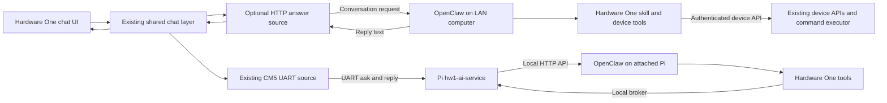

# OpenClaw integration plan

Status: consolidated into `main` for the 0.99.98 development checkpoint.
The HTTP source remains optional and off in ordinary profiles; the saved
OpenClaw profiles enable it. XIAO HTTPS chat, continuity and New chat passed
hardware tests on the earlier 0.99.97.4-based image. P4 local speech and the HTTP
source are now combined in source; their end-to-end voice test remains pending.
UART OpenClaw remains the second milestone. See [working status](OPENCLAW_WORK_STATUS.md)
and [setup](OPENCLAW_SETUP.md) for current evidence and limits.

The findings below describe the original extension points in `154ad982`
(v0.99.95); line numbers refer to that historical baseline. The earlier
`codex/openclaw-integration-plan` branch is no longer the active source.

The user's OpenClaw host is on a separate VLAN from the Mac mini. Keep the
VLANs isolated. Device tests use password-protected `TestESPNetwork` on the
OpenClaw host's VLAN and USB from the Mac mini. Do not add routing, forwarding
or a network bridge.

The user selected direct communication from the ESP device to an OpenClaw
computer on the same Wi-Fi/LAN for the first version, then clarified that both
Wi-Fi and UART should be supported eventually. Running OpenClaw on the attached
Pi is an explicit goal. Design UART to work without Wi-Fi. The goal is
conversation through Hardware One with minimal impact on current development.

## Recommended boundary

Use the existing LLM backend contract for both routes: add an optional HTTP
source for direct Wi-Fi, then extend the CM5 host adapter for UART OpenClaw.
Keep OpenClaw's reasoning, memory, and tool execution on its host. Separately,
provide a Hardware One skill and small device client on that host for device access.
The skill is optional for conversation; it is needed when the agent should
read sensors or operate the device.



Use ordinary HTTP/JSON and streaming events at the OpenClaw boundary. Reuse
the authenticated UART protocol at the ESP/Pi boundary. A custom OpenClaw channel, native
node client, MQTT bridge, and ESP-side agent runtime are outside this first
version. Native OpenClaw nodes introduce a separate command transport and
device lifecycle; revisit them if background delivery or richer integration
becomes a concrete requirement. [OpenClaw nodes](https://docs.openclaw.ai/nodes)

## Evidence and current limitations

- `System_LLMBackend.h:4` explicitly anticipates another HTTP source. The existing
  start/poll/chunk/done contract can carry its answers to the current interfaces.
- `System_LLMBackend.cpp:96` aggregates source entries; selection and dispatch
  are centralized in the same module. Existing sources are onboard and CM5.
- `System_LLMChat.cpp:306` starts a turn while holding the chat lock. Network
  activity must run in a worker; start, enumerate, and poll calls must remain fast.
- `System_LLMChat.cpp:340` sends only the current prompt. The local history ring
  is display history, not a multi-turn request transcript.
- `System_LLMChat.cpp:447` clears local history only. A remote conversation
  needs its own reset hook. The integer generation ID is not that conversation ID.
- `System_LLMChat.cpp:356` retries by resending the prompt. Replaying a prompt
  to an agent could execute an action again.
- `System_LLMChat.h:42` caps history at 16 turns and 2,048 bytes per turn;
  `System_LLMChat.cpp:195` can discard overflow. Long agent replies need explicit
  truncation handling instead of silent success.
- `System_LLMBackend.cpp:433` has CM5-specific deferred startup, while
  `HardwareOne.cpp:2139` guards boot startup on the onboard source. An HTTP-only
  build needs its own deferred startup coverage.

Paths above are relative to `components/hardwareone/`.

## What the UART implementation already does

The ESP does not call an Ollama API. Its CM5 adapter sends `llm_select`,
`llm_ask`, and `llm_cancel` events. The Pi publishes models and sends
`cm5 llm loading/ready/push/end` replies. Sequence and request IDs prevent old
or duplicated chunks from contaminating a newer answer; authenticated UART
session ownership and bounded timeouts control the lifetime.

The companion repository was inspected at commit
`9b8aa2b585eee00e39990f7ac7745ad0e1fee0b9` on 2026-10-12:

- Its Python `LlmClient.ask_stream` calls a **llama.cpp llama-server** using
  `/v1/chat/completions`, reads streamed text, and maintains its own history.
  This inspected path is not an Ollama client. The API shape is relevant to
  OpenClaw, but its llama-specific request fields and history policy are not
  suitable for copying unchanged. [Existing client](https://github.com/CadenGithubB/HardwareOne_RaspPi_CoProcessor/blob/9b8aa2b585eee00e39990f7ac7745ad0e1fee0b9/ai-service/hw1_ai_service/llm/client.py)
- `Cm5LlmService` currently discovers GGUF files and couples selection to the
  model supervisor. Add a distinct configured agent target/client on the host
  rather than treating OpenClaw as a GGUF file or restarting its model server.
  Existing stream batching, keepalives, and UART result delivery are reusable.
  [Existing CM5 adapter](https://github.com/CadenGithubB/HardwareOne_RaspPi_CoProcessor/blob/9b8aa2b585eee00e39990f7ac7745ad0e1fee0b9/ai-service/hw1_ai_service/cm5_llm.py)
- The repository already contains a separate OpenClaw installation profile.
  It is currently notes-only, loopback-bound, and restricted from shell/UART
  access. This is useful groundwork, not an existing device conversation
  bridge. New device tools need an explicit narrow integration with that
  profile. [Pi OpenClaw profile](https://github.com/CadenGithubB/HardwareOne_RaspPi_CoProcessor/blob/9b8aa2b585eee00e39990f7ac7745ad0e1fee0b9/ai-service/openclaw/README.md)

Use CM5 as the implementation example for a bounded remote answer source;
reuse Backend/Chat directly. UART whitespace escaping and frame parsers should
stay in the serial path. HTTP JSON/SSE parsing is different code. Audit the two
repositories' protocol constants together: the inspected host still documents
older prompt/stall bounds than this firmware.

## OpenClaw wire contract

Its optional `POST /v1/chat/completions` endpoint runs the configured agent.
It is enabled through `gateway.http.endpoints.chatCompletions.enabled`.
Bearer authentication uses the gateway credential. `model: "openclaw/default"`
selects the default agent; `openclaw/<agentId>` selects a particular one.
A stable `user` string continues a conversation. Streaming uses SSE and ends
with `[DONE]`; errors can follow partial output. Shared gateway credentials
carry operator authority. These details must be checked against the installed
OpenClaw version before the prototype. [OpenClaw HTTP API](https://docs.openclaw.ai/gateway/openai-http-api)

Proposed request, with illustrative values only:

```json
{
  "model": "openclaw/default",
  "user": "hw1:device-id:conversation-nonce",
  "stream": true,
  "messages": [{"role": "user", "content": "What is the temperature here?"}]
}
```

The HTTP wire format is reusable, but this first source is qualified against
OpenClaw's session behavior. Do not promise equivalent memory behavior from
arbitrary compatible model servers. Omit client-side function tools: the host
skill owns device actions. Do not copy tiny-model sampling, sentence limits,
or token caps indiscriminately into agent requests.

## Minimum firmware changes

| Area | Proposed change |
| --- | --- |
| New source module | `System_LLMHttp.h/.cpp`: configured endpoint, worker, bounded request/response buffers, JSON/SSE parsing, stop, timeout, status |
| Backend registry | `System_LLMBackend.h/.cpp`: HTTP kind, one configured alias such as `http:openclaw`, dispatch, availability and deferred startup |
| Shared chat | Conversation-reset and retry-capability hooks; retain existing onboard/CM5 behavior; expose truncation/error state where needed |
| Build integration | Optional `ENABLE_LLM_SOURCE_HTTP`, default off; literal flag parsing, consistency guards, conditional source/dependency in CMake |
| Settings | Endpoint, agent target, credential, and enable setting through the existing settings schema; secret storage and redaction |
| Existing interfaces | Verify source selection/status; small capability-driven changes only for retry and truncation where required |

These are the first Wi-Fi milestone's changes. Keep conversation reset and
retry capability in the common backend contract so UART can adopt them later.
Do not create a general transport framework or refactor the working UART source
just to add the first route.

Start with one configured target. Model discovery and a general multi-provider
configuration system add work without proving the core user experience.
Keep transport logic in the new file; avoid restructuring existing backends.
Reuse secret-field support in `System_Settings.h/.cpp` and the LLM settings
module in `System_LLMCommands.cpp`. Ensure credentials never enter status,
logs, model IDs, or normal settings responses.

## Conversation and failure rules

1. First version assumes a personal device with one shared conversation across
   its chat interfaces, matching the current global chat layer. Multi-user
   isolation is a separate requirement, not something a shared `user` ID grants.
2. Allocate a random conversation nonce at startup. Reuse it for subsequent
   turns. Clear/New chat, endpoint changes, and agent changes start a new nonce;
   reboot starts fresh initially. A network reconnect alone keeps the nonce.
3. Clearing the local view starts a new remote conversation; it does not claim
   to delete the old host transcript or erase the agent's long-term memory.
4. OpenClaw owns conversation history. Send the latest user message once;
   avoid uploading the truncated display ring as a second history source.
5. Refuse generic Retry for this source initially. Do not automatically replay
   a POST after timeout, disconnect, or ambiguous completion. Show the error
   and preserve partial text; completed tool actions cannot be undone by retry.
6. Stop closes/cancels the active transport and releases local state. Verify
   host cancellation behavior, but never claim already completed actions were
   rolled back. Ignore late output from cancelled or replaced generations.
7. Parse fragmented JSON/SSE and UTF-8 incrementally, handle partial errors and
   missing completion markers, and bound memory. Keep the device HTTP server
   responsive so the agent can call back into it during a conversation.
8. Ask for concise device-friendly answers in host guidance. Mark truncation
   when the local display cap is reached; do not silently increase memory use
   or abort useful host work merely to limit text displayed on the device.
9. Initially, changing Wi-Fi/UART route starts a new conversation and requires
   the current turn to finish or stop. Seamless switching with the same
   transcript can be added later through an explicitly shared agent/conversation
   identity. Never silently fail over and repeat an action on the other route.

## UART OpenClaw follow-up

On the Pi, add an OpenClaw API client behind the existing ask/stream/cancel
adapter. A configured target could appear as `cm5:openclaw` alongside GGUF
targets. The Pi retains the gateway credential and calls its loopback API;
the ESP uses its existing authenticated UART relationship.

The current UART ask identifies one generation, not the remote conversation.
It also has no remote chat-clear operation or agent capability advertisement.
Add a small, negotiated extension for agent capabilities and explicit
conversation context. An agent-aware request such as `llm_ask2` could carry both
request and conversation IDs; Clear rotates the latter. Keep legacy `llm_ask`
unchanged. Never append fields to its escaped-prompt tail, where they become
user text. Optional catalog capability metadata is structurally possible, but
must be tested against both parsers before selecting the exact wire syntax.
An old peer should continue ordinary model chat and report agent mode unavailable.

Reuse existing stream callbacks where their semantics fit. Advertise enough
capability information to disable regeneration for agent targets without changing
ordinary CM5 model behavior. Make host errors and cancellation bounded and
visible. Test the UART bridge with the Wi-Fi radio disconnected.

## Hardware One skill: one operation set, two adapters

An OpenClaw skill supplies instructions for tools; it does not create network
access or authorization. Define a small operation set such as `device_info`,
`read_sensor(sensor_id)`, and one bounded action. Supply host-side tools/client
code that implements those operations using the selected transport. Keep
credentials outside the skill text. [OpenClaw skills](https://docs.openclaw.ai/tools/skills)

The Pi's restricted OpenClaw profile needs narrow tools explicitly registered
and allowed; a Markdown skill plus a shell script alone will not run there.
Those tools can use a local broker in the existing daemon. It remains the sole
serial owner: never open a second UART client or grant the agent broad shell
or serial access. Validate arguments and construct allowed commands in the
broker, with the device's account permissions as a second boundary.

On Wi-Fi, the same operations use the APIs below. Ensure the agent's actual
execution environment can reach the LAN.

| Operation | Existing device API |
| --- | --- |
| Identify | `GET /api/ping` |
| Discover capabilities | `GET /api/buildconfig`, `GET /api/devices` |
| Read status/sensors | `GET /api/system`, `GET /api/sensors/status`, per-sensor `/api/sensors?sensor=...` |
| Execute an allowed command | `POST /api/cli`, URL-encoded form `cmd=...` |

On UART, reuse the daemon's existing authenticated command session and the
ordinary device command API. `devicefile`, `sensors json brief`, individual
sensor reads, and `temperature json` are candidate discovery/read operations.
Use an ordinary-user service session for those commands; HTTP guest read access
does not imply a guest can execute UART commands. Do not hold the serial command
lock across the OpenClaw HTTP request: agent tool callbacks must work while the
answer is in progress. The current UART dispatcher already uses the shared
executor and checks live-session ownership (`System_UartLink.cpp:1074`).

Start with read-only discovery and one real sensor. Add a small explicit action
set after that works. Use the device's existing account roles and command
executor. A guest is suitable for permitted HTTP GET requests; a dedicated
ordinary user supports non-admin CLI actions. Enforce the broker's narrow
operation list in code, in addition to device-side permissions.

Current device auth is Basic username/password or a session cookie, not a
general inbound bearer-token API (`WebServer_Server.cpp:790`). Keep the two
credentials distinct: ESP-to-OpenClaw gateway auth, and host-to-ESP device auth.
Basic request/response calls minimize changes. Session-bound event streams and
interactive confirmations are deferred; Basic alone does not support them.
Use the REST discovery routes instead of granting admin for `features json`.
Commands that require interactive confirmation should fail with a clear reason
until a deliberate approval flow is supported.

Keep API responses bounded and normalize text/JSON in the helper. Commands
remain subject to device permissions. No new ESP HTTP API or auth system is
needed to test the Wi-Fi skill. Source: `WebServer_Server.cpp:3151,3613`,
`WebServer_Events.cpp:37,156`, and `System_CommandLimits.h`.

## LAN and voice scope

For direct Wi-Fi, configure a stable LAN hostname/address and reachable
authenticated gateway ingress; localhost on the ESP points to the ESP itself. Keep the integration
private. Prefer verified TLS for credential-bearing traffic in both directions;
any plaintext bench mode should be an explicit development choice. Existing
device HTTPS may fall back to HTTP, so the helper must verify the actual scheme
and refuse silent downgrade. Avoid embedding an operator gateway credential
in distributable firmware; provision it as a device secret. A restricted host
proxy is a later option if the device must have narrower gateway authority.

For UART mode, OpenClaw can retain its loopback-only gateway and the Pi keeps
its secret. The tool broker stays local to the Pi; ESP access travels over the
existing authenticated serial session. The current Pi installer restrictions
still need a specific allowance for these local tools and the daemon's gateway
access. Inspect its pinned OpenClaw API support before changing configuration.

Prove text conversation first. Existing dictation can supply text where it
already feeds the shared chat layer; a chat endpoint does not supply raw-audio
transcription or spoken replies. The native G2 "Hey Even" route has CM5-specific
behavior and requires a separate follow-up audit/change. Do not assume adding
an answer source reroutes every voice path, and do not make a speech overhaul
part of the first integration.

## Small implementation stages

1. **Host/API proof:** verify the installed OpenClaw version, two-turn memory,
   a fresh conversation, and a read-only skill call to the device. Firmware
   remains unchanged in this stage; tests run from a host client.
2. **Optional ESP source:** implement the worker, configuration, one registry
   entry, and lifecycle hooks. Exercise the normal chat UI with typed input.
3. **Device action and interface checks:** enable one non-admin action through
   the skill, verify permissions and callback responsiveness, then verify web,
   OLED, and G2 chat selection plus existing dictation paths.
4. **Pi/UART support (planned):** add the host agent target/client, negotiated
   conversation/capability extension, and narrow local device tools. Prove
   two-turn chat and a sensor/tool round trip with ESP Wi-Fi disabled.
5. **Later, if needed:** native voice routing, richer remote conversation
   controls, proactive agent notifications, per-device scoped credentials,
   model discovery, multiple agents, and remote-network access.

Acceptance checks: HTTP-only build; mixed-source build; HTTP-disabled build;
two-turn memory; fresh chat; source switch; offline host; invalid credentials;
fragmented/oversized/erroring stream; stop and late responses; no duplicate
action on response loss; redacted secrets; agent callback while chat is active.
For UART also check daemon reconnect/session revocation, agent callbacks during
streaming, legacy peer compatibility, and route changes without replay. Build/test
only the relevant profiles, then qualify on the target ESP board.

## Handoff

This branch currently contains the plan only. No OpenClaw instance was contacted
and no end-to-end behavior has been tested. Before coding, reconcile changes
to the shared LLM/backend/settings files with the user's ongoing work. The
first implementation can be split into independent host device tools and the
bounded Wi-Fi firmware source, followed by their integration test. UART agent
support is an explicit second milestone using the existing Pi bridge.
