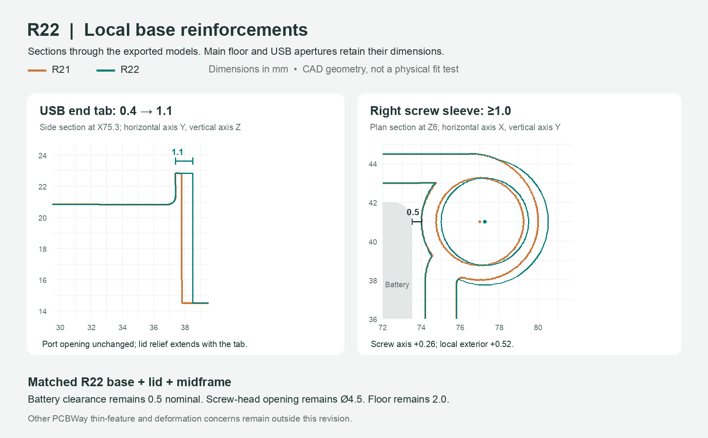

# R22 — USB end tab and lower screw sleeves

This revision addresses two base features identified in PCBWay's engineering
review for order **C-1K3W1162240A**. The lid (order **C-1K6W1162240A**) and
midframe also change to keep the assembly aligned. Units are millimetres.

## Geometry changes

| Feature | R21 | R22 |
|---|---:|---:|
| Rear USB opening end tab, along Y | 0.4 | 1.1 |
| Rear end of base USB rail | Y37.8 | Y38.5 |
| Rear end of downward-open lid relief | Y38.0 | Y38.7 |
| Lower screw sleeves | Clipped by shell; about 0.75–0.79 locally | Unclipped Ø6.52 around Ø4.5 bores |
| Right case screw axis, assembly XY | (77.0, 41.0) | (77.26, 41.0) |
| Right sleeve to nominal battery | 0.5 | 0.5 |
| Maximum base X | 80.0 | 80.52 |

The 64-facet sleeve geometry retains at least **1.006 mm** around the screw-head
bore by a conservative polygon bound. Sleeves stop at the existing Z11.5
shoulder, below the midframe. The three other sleeves also need their original
corner clipping removed to avoid retaining thin outer walls.

The right screw moves outward by 0.26 mm, as selected by the builder. The
matching lid insert and midframe relief move with it. The original shell
profile, nominal 2 mm floor, battery position, PCB position, screw-head bore,
screw seat height, screw length, USB aperture dimensions and control mechanism
stay unchanged. The battery locators are trimmed around the reinforced sleeves.

The USB lid relief stays open through the lower edge for straight vertical
assembly. It retains a nominal 0.2 mm rear fitting gap. The shifted right
insert entrance retains approximately 1.026 mm of material beside this relief.

## Matched file set

Replace these three parts together:

- `stl/p4x-eye-base-r22.stl`
- `stl/p4x-eye-lid-r22.stl`
- `stl/p4x-eye-midframe-r22.stl`

Reuse these R21 parts without geometry changes:

- `stl/p4x-eye-button-strip-r21.stl`
- `stl/p4x-eye-button-keeper-r21.stl`
- `stl/p4x-eye-power-slider-r21.stl`

The editable model is `enclosure.scad`; release dimensions are recorded in
`dimensions-r22.json`. Import STL files in millimetres at 100% scale. Their
print positions are not assembly coordinates. Orientations remain floor-down
for the base, exterior-face-down for the lid and underside-down for the frame.
The new right screw alignment means the R22 base must not be mixed with an
R21 lid or frame. Retained R21 PDFs are historical and show the old screw axis.

## Scope and verification

All three final CGAL exports pass the strict topology check without repairs:
one closed manifold component, consistent winding, positive volume and no
degenerate/duplicate faces or invalid edges/vertices. Actual base sections at
Z5 and Z10 measure at least 1.00877 mm around all four sleeves. The rear USB
tab measures 1.099998 mm at X75.3, Z22.

All ten nominal CAD collision probes passed, including 37 sampled lid
insertion positions and a continuous conservative USB-tab insertion envelope.
The topology and actual-CAD collision results are recorded in
`validation/base-reinforcement-r22.json`. The release manifest records the
source and STL hashes. CAD checks do not replace a physical fit check.

This is a local reinforcement revision, **not complete PCBWay manufacturing
approval**. It does not resolve the lid's other thin features, the 0.8 mm
button arms or power-slider flange, the supplier's deformation waiver, insert
installation, or its separately reported damaged-file locations. Request a
new supplier check of the exact revised files before printing. No material
change or supplier risk acceptance is included in this revision.
