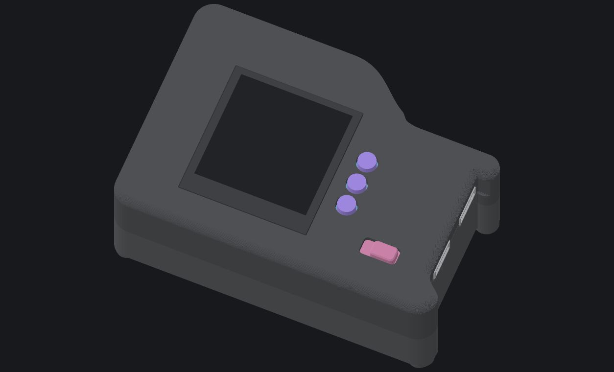
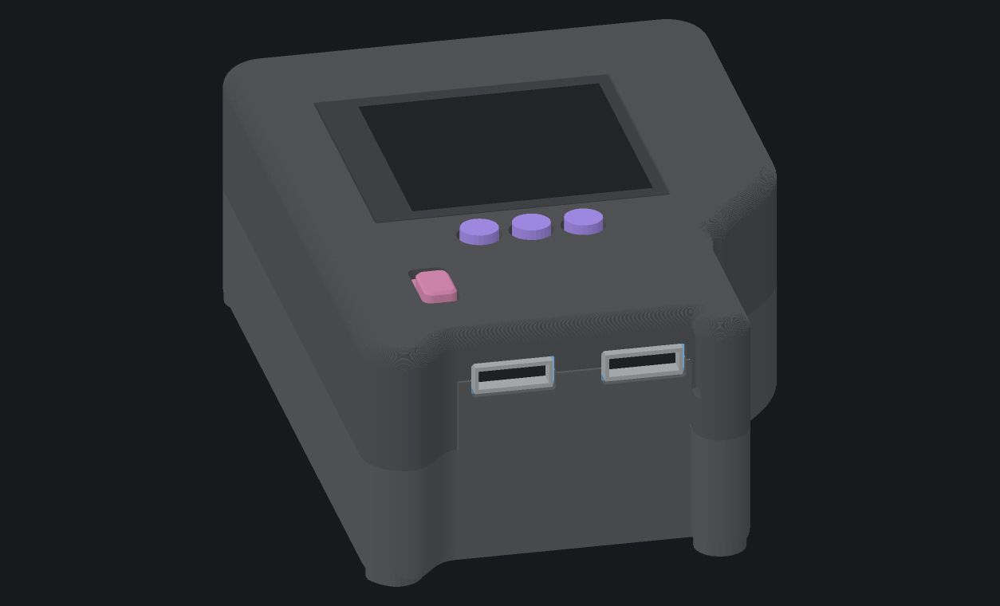
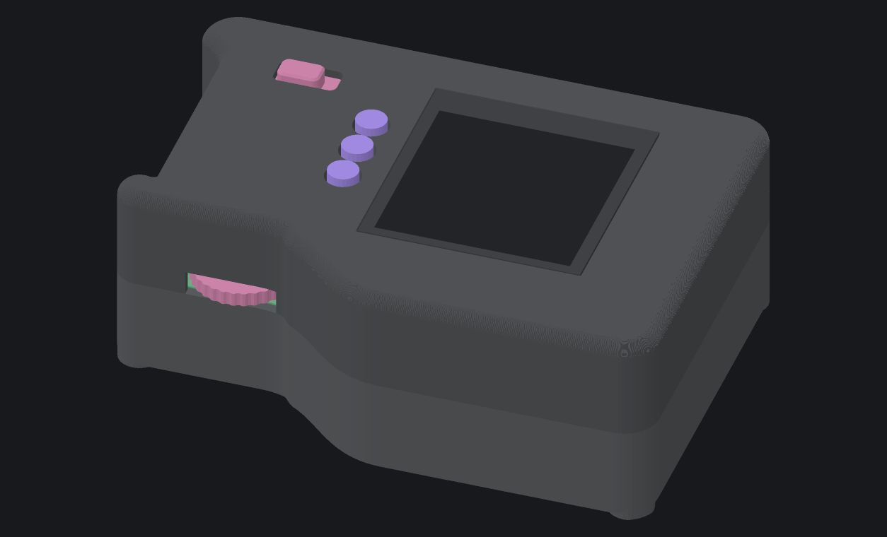
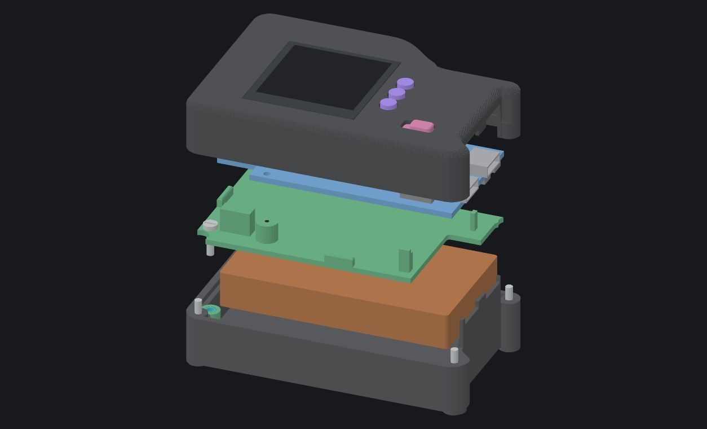
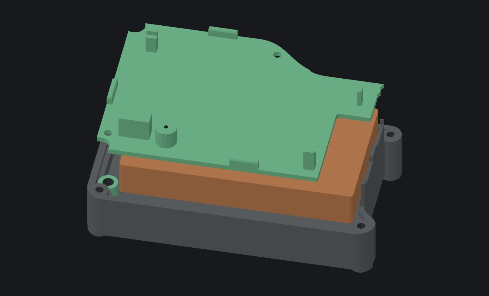
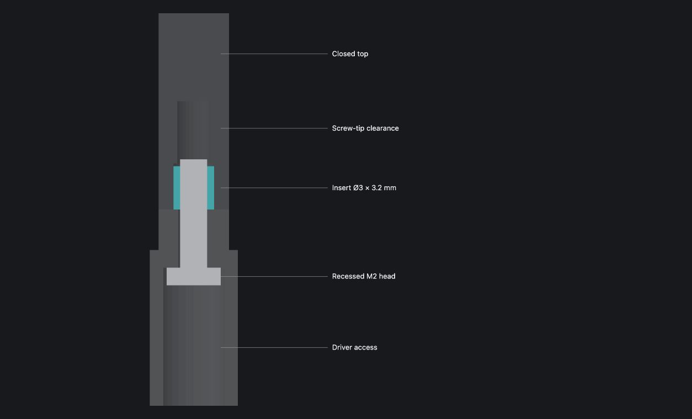

# ESP32-P4X-EYE enclosure — camera omitted

Revision 26 restores the full-height screw-well sleeves that revision 25 had
unintentionally cut back to 0.49-0.76 mm between Z1 and Z2. Everything else is
the R25 geometry: continuous 1 mm face chamfers, 0.50 and 0.70 mm button-strip
steps, and support, slider and lid guides updated together to retain the
reviewed **0.25 mm nominal per-side clearances**. Use **all six R26 files
together**. See [R26 changes and verification](R26_SLEEVE_CONTINUITY.md),
[R25 changes](R25_MANUFACTURING_REFINEMENT.md),
[R26 dimensions](dimensions-r26.json), and the
[assembly and finish drawing](output/pdf/p4x-eye-r26-pcbway-assembly.pdf).

The button arms remain 1 mm thick x 2 mm wide. The battery compartment remains
11 mm high, including 0.5 mm below and above the nominal 10 mm pack. Full varnish
is requested on all surfaces, subject to PCBWay's process and finished-fit
review. Physical fit, button durability and deformation resistance remain
unqualified. The editable CAD requires OpenSCAD's experimental `roof` feature;
the export and checking tools enable it automatically.

The R21 design shown in the photographs below is a compact enclosure for the ESP32-P4X-EYE board with its
detachable camera left off. It carries the board, display, and a
36 × 65 × 10 mm battery in an 80 × 56 × 29 mm body. The screen, three top
buttons, power switch, rotary wheel, microSD slot, and both USB-C ports remain
usable.

The colours in these renders distinguish the printed parts, PCB, display, and
battery. They are not the intended finish; the enclosure is intended for clear
resin. The physical fit of this R21 design has been verified by the builder.

## Finished enclosure

The display sits in a recessed lid seat, close to flush with the top surface.
The three printed buttons extend about 1 mm above the lid so they are easy to
find and provide a little screen protection when the device is face-down. The
small pink cap is the printed power-slider extension.

## Ports and controls

Both USB-C ports meet the enclosure edge through close-fitting openings. The
right-hand side has a local scallop so a 10.25 × 6 mm cable housing has room
beside the corner fastener.

The wheel-side wall follows the original controller more closely than a simple
rectangular cutout. That exposes the rotary wheel for fingertip use while
keeping the rest of the corner closed and rounded. The same edge keeps the
microSD area accessible.

## Inside the case

The enclosure is arranged as a lid and display, the EYE board, a midframe, the
battery, and the base. The printed button strip, keeper, and power slider
complete the lid controls.

The midframe follows the irregular board outline, locates the board through
its mounting tab, and sits flat over the battery. Its open bay gives the
battery lead a clear route to the board connector without trapping the cable.

## How it closes

The base, midframe, and lid use locating keys as well as screws. Four M2 case
screws enter from the underside into blind lid insert pockets, so no case-screw
heads appear on the top face. Two more M2 screws secure the midframe to the
base. The board uses its own small mounting point in the midframe.

## Model files

The printable set has six pieces: base, lid, midframe, button strip, button
keeper, and power slider. The editable source is
[enclosure.scad](enclosure.scad); the matching printable files are in
[stl/](stl/), and supplier drawings are in [drawings/](drawings/).

The R26 matched set is:

- `stl/p4x-eye-base-r26.stl`
- `stl/p4x-eye-lid-r26.stl`
- `stl/p4x-eye-midframe-r26.stl`
- `stl/p4x-eye-button-strip-r26.stl`
- `stl/p4x-eye-button-keeper-r26.stl`
- `stl/p4x-eye-power-slider-r26.stl`

Use the source and file hashes in `stl/export-manifest-r26.json` to identify the
matching files. The retained R21 supplier drawings show the old right screw
position and older fits; they are **not R26 manufacturing drawings**. R21-R25 files and validation records
remain available as historical releases. The R26 PDF gives assembly and
finishing instructions; matching STL files govern geometry.

## Portable validation records

The R22–R25 repository ZIPs normalize absolute build-machine paths in their
JSON provenance. Their source, STL and drawing bytes are unchanged. Package
validation records include both the original archive digest and the current
portable-copy digest. The R25 delivery record keeps the original sent-attachment
digest separately from the repository copy; normalizing metadata is not a new
shipment or a new geometry qualification. Private correspondence stays local.
